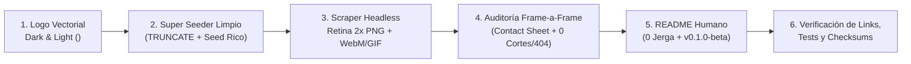

# Playbook Senior: Capturas Headless Reales, Videos Cortos de Uso, Auditoría Visual Frame-a-Frame y README para Cualquier Usuario

**Estado:** playbook operativo canónico multistack. **Owner:** `playbooks/`.  
**Estándares asociados:** [Estándar de README](../standards/engineering/readme-standard.md) · [Versionado y Releases (`0.1.0-beta`)](../standards/engineering/repository-versioning-and-releases.md).

Este playbook documenta el flujo completo ejecutado en producción de ingeniería (caso real **AgentOps `0.1.0-beta`**) para transformar una aplicación real en un **`README.md` visual de primer nivel** (estilo *Craft Anything*, *Twenty* y *NestJS*), garantizando **cero mocks falsos**, **logos adaptables Dark/Light**, **datos ricos mediante Super Seeder**, **auditoría visual obligatoria de cada imagen y video**, y **lenguaje claro apto para cualquier usuario**.

---

## 1. Resumen del Flujo de 6 Fases (`READ → SEED → CAPTURE → AUDIT → WRITE → VERIFY`)



---

## 2. Fase 1 — Logo Oficial Adaptable a Modo Claro y Modo Oscuro

Cuando el usuario entrega un icono o logo de marca:

1. **Medir proporciones reales antes de trazar SVG:** Analizar el bounding box, radio de esquina (`rx`) y coordenadas exactas (ej. con Python `PIL` / `numpy`) para que el SVG sea 1:1 fiel al diseño original.
2. **Generar ambas variantes cromáticas en `docs/assets/`**:
   - `docs/assets/logo-light.svg` (+ `logo-light.png`): Fondo oscuro (`#09090B`) con isotipo blanco (`#FFFFFF`) para verse con máximo contraste sobre el fondo blanco de GitHub Light Mode.
   - `docs/assets/logo-dark.svg` (+ `logo-dark.png`): Fondo luminoso (`#FAFAFA` con borde sutil `#E4E4E7`) e isotipo oscuro (`#09090B`) para resaltar sobre el fondo `#0D1117` de GitHub Dark Mode (un icono negro puro sobre fondo oscuro desaparece).
3. **Incluir `<title>` accesible dentro de cada `<svg>`** para cumplir accesibilidad WCAG y reglas de linters (`lint/a11y/noSvgWithoutTitle`).
4. **Integrar el mismo logo en la propia aplicación (`<BrandLogo />` + `public/favicon.svg`)** usando clases adaptables (`fill-neutral-950 dark:fill-neutral-50`) para que todas las capturas y videos muestren la identidad oficial cambiando en vivo entre modo oscuro y claro.
5. **Renderizar vista previa lado a lado (`#FFFFFF` vs `#0D1117`) con Chromium headless y revisarla visualmente** antes de continuar.

---

## 3. Fase 2 — Super Seeder Determinista (Cero Pantallas Vacías o Sucias)

Un README pierde toda credibilidad si sus capturas muestran tablas vacías (`No data yet`) o basura residual de tests automatizados (`QA Test 9981`, `Untitled draft`).

1. **Limpiar filas residuales antes de sembrar:** Ejecutar `TRUNCATE TABLE ... CASCADE` sobre el entorno local antes de correr `db:seed` para eliminar restos de ejecuciones E2E previas.
2. **Poblar datos realistas y completos en cada módulo:**
   - Grafos visuales con coordenadas `position: { x, y }` bien distribuidas para que los nodos no se solapen ni crucen aristas.
   - Ejecuciones completadas con todos sus pasos (`start` → `agent` → `tool` → `output`) y tiempos reales.
   - Solicitudes pendientes de aprobación listas para ser aprobadas en vivo durante la grabación del video.
   - Documentos indexados listos (`ready`) con vectores reales para que las búsquedas devuelvan citas reales en cámara.
3. **Restaurar el Super Seed automáticamente al terminar la grabación:** Si uno de los videos aprueba una solicitud o publica un borrador, el propio script debe re-ejecutar el seed limpio al finalizar para dejar la base de datos en estado determinista.

---

## 4. Fase 3 — Automatización Headless de Capturas Retina 2x y Videos Cortos (`.webm` + `.gif`)

Usar **Playwright (`chromium.launch({ headless: true })`)** o **Puppeteer** contra la aplicación real levantada localmente (jamás mockups estáticos):

### 4.1. Capturas Estáticas de Alta Densidad (`2x Retina`)
- Configurar `viewport: { width: 1440, height: 900 }` y `deviceScaleFactor: 2` (`2880x1800` píxeles reales).
- Capturar tanto **Dark Mode** como **Light Mode** para demostrar soporte visual completo.
- Seleccionar explícitamente nodos o elementos ricos (ej. hacer clic en un nodo del workflow antes de tomar la foto para que el panel Inspector derecho muestre su configuración real en lugar de un texto vacío).

### 4.2. Grabación de Videos Cortos de "Cómo Usar la Aplicación" (`.webm` + `.gif`)
- En navegadores headless el cursor del sistema operativo no aparece en el video. **Inyectar un cursor visual flotante (`div` con transición suave + pulso verde al hacer clic) y una píldora discreta de paso (`1/4` … `4/4`)** exclusivamente durante la grabación para guiar la vista del usuario.
- Grabar simultáneamente:
  1. **Video nativo `.webm` HD** mediante `recordVideo: { dir, size: { width: 1280, height: 800 } }` guardado en `docs/assets/videos/`.
  2. **GIF animado auto-reproducible en GitHub** guardado en `docs/assets/demos/`, codificado desde frames PNG secuenciales con Python `Pillow` (`Image.Resampling.LANCZOS` + `Image.Quantize.MEDIANCUT`, `256` colores, `dither=Image.Dither.NONE` para mantener bordes y tipografía ultra nítidos por debajo de `~1.2 MB`).
- ¿Por qué ambos formatos? GitHub Markdown **reproduce automáticamente `.gif` inline**, pero bloquea `<video src="ruta-relativa.webm">`. Embebiendo el `.gif` y poniendo debajo el enlace directo al `.webm` HD se obtiene reproducción inmediata en GitHub y video de alta definición en el repositorio.

---

## 5. Fase 4 — Regla Crítica: Auditoría Visual Obligatoria de Cada Imagen y Frame de Video

> [!IMPORTANT]
> **Prohibido enlazar una captura o video en el `README.md` sin haberlo abierto y revisado visualmente antes.** Un script que termina con `exit code 0` puede haber fotografiado una pantalla `404 Not Found`, un spinner de carga o un resultado cortado fuera del viewport.

### Protocolo de Revisión Visual Senior:
1. **Inspeccionar el 100% de los PNG generados:** Verificar encuadre, contraste en modo oscuro/claro, ausencia de banners de error y presencia de datos reales.
   - *Ejemplo real detectado y corregido en AgentOps:* La primera captura de API apuntaba a `/docs` (devolviendo `404`), cuando Scalar estaba montado en `/reference`; y en la vista de Knowledge el cuadro de resultados quedaba `40px` debajo del borde inferior antes de hacer `window.scrollTo`. La inspección visual detectó ambos fallos antes de publicar.
2. **Generar Lámina de Contacto (`Contact Sheet`) de todos los frames de cada GIF:**
   ```python
   from PIL import Image, ImageDraw

   im = Image.open("docs/assets/demos/demo.gif")
   cols, tw, th = 4, 420, 262
   rows = (im.n_frames + cols - 1) // cols
   sheet = Image.new("RGB", (cols * tw, rows * th), (15, 15, 18))
   draw = ImageDraw.Draw(sheet)
   for idx in range(im.n_frames):
       im.seek(idx)
       frame = im.convert("RGB").resize((tw - 8, th - 24), Image.Resampling.LANCZOS)
       x, y = (idx % cols) * tw + 4, (idx // cols) * th + 20
       sheet.paste(frame, (x, y))
       draw.text((x + 4, y - 16), f"Frame {idx+1}/{im.n_frames}", fill=(240, 240, 245))
   sheet.save("gif_contact_sheet.png")
   ```
3. **Validar coherencia exacta Imagen/Video ↔ Descripción:** Cada pie de foto (`<sub>`) y párrafo descriptivo debe narrar **exactamente lo que ocurre y se ve en esa imagen o video**, en el mismo orden de pantallas.

---

## 6. Fase 5 — Redacción del `README.md` para Cualquier Usuario (Cero Jerga Críptica)

El `README.md` principal de un producto es leído por fundadores, líderes de producto, operadores, clientes y desarrolladores. Siguiendo el patrón de repositorios líderes (*Craft Anything*, *Twenty*):

1. **Narrativa Principal 100% Humana y Orientada a Valor:**
   - Explicar **qué puede hacer la persona** con la aplicación usando palabras cotidianas, claras y directas.
   - **Prohibido** saturar los títulos, el pitch o los pies de foto con jerga interna de implementación (`MATERIALIZED CTE`, `ts_rank_cd RRF`, `TOCTOU SHA-256`, `RS256 JWKS`, `lease_until`, nombres de scripts internos de auditoría).
2. **Divulgación Progresiva (`<details>`) para Detalles de Ingeniería:**
   - Mantener el flujo principal limpio (Hero con versión `0.1.0-beta` y botón de descarga → Por qué usarlo → Videos cortos de cómo funciona → Modo Oscuro/Claro → Galería visual de pantallas → Descarga y Arranque en 2 pasos → Preguntas frecuentes).
   - Agrupar el mapa interno de carpetas, comandos de compilación local sin Docker y suites de tests dentro de un bloque desplegable `<details><summary><b>🛠️ For Developers & Contributors</b></summary>...</details>` o enlazar a `architecture/`.

### Comparativa Verificable de Pies de Foto y Descripciones

- ✅ **Correcto (Claro para cualquier usuario y 100% fiel a la imagen):**
  > *"The visual workflow builder: add steps from the left panel, connect them on the canvas in the middle, and click any step (here, **Triage Agent**) to view or edit its settings on the right."*
- ❌ **Incorrecto (Jerga interna críptica o desconectada de lo que se ve):**
  > *"React Flow DAG serializing Zod SSOT discriminated unions with optimistic concurrency revision locks and Drizzle JSONB persistence."*

---

## 7. Fase 6 — Verificación Automatizada de Enlaces, Badges e Imágenes con `curl` (Senior Mode)

Antes de cerrar la tarea o hacer cualquier commit/release, es **obligatorio** ejecutar un validador automatizado (`verify_readme_assets.py`) que audite dos frentes con rigor estricto:

### 1. Verificación Activa de URLs Remotas, Badges e Imágenes con `curl` (`Zero Broken Links / Images`)
- **Protocolo de verificación**: Para cada enlace externo (`https://...`), badge de Shields.io (`img.shields.io`), enlace de descarga de releases y CDN de medios, ejecutar:
  ```bash
  curl.exe -I -s -f -L -A "Mozilla/5.0" --connect-timeout 8 --max-time 15 "<URL>"
  ```
- **Fallback a GET**: Si un servidor o CDN restringe solicitudes `HEAD` (devolviendo 403 o 405), el validador ejecuta fallback automático con `--range 0-1024` mediante `GET`.
- **Cero tolerancia a 404/500**: Si cualquier badge, enlace o imagen arroja código de error HTTP o fallo DNS/timeout, la suite se detiene inmediatamente en estado `FAIL`.
- **Sintaxis de badges en Shields.io**: Los guiones en versiones pre-release (`0.1.0-beta`) DEBEN escaparse con doble guion (`0.1.0--beta`); de lo contrario, Shields.io genera un badge inválido o error 400.

### 2. Verificación de Activos Locales en Disco
- Comprobar que **todos** los `src="..."`, `srcset="..."`, `href="..."` y enlaces Markdown `](...)` locales existen físicamente en disco (`missing = 0`).
- Comprobar que **ningún archivo local tenga 0 bytes** (`st_size > 0`).

### 3. Gates Finales de Calidad
- Ejecutar los gates de calidad del repositorio (`lint`, `typecheck`, `test:unit`, `test:e2e`) para confirmar que la integración del logo, favicon o estilos no introdujo regresiones.
