<div align="center">
  <picture>
    <source media="(prefers-color-scheme: dark)" srcset="docs/assets/logo-dark.svg" />
    <source media="(prefers-color-scheme: light)" srcset="docs/assets/logo-light.svg" />
    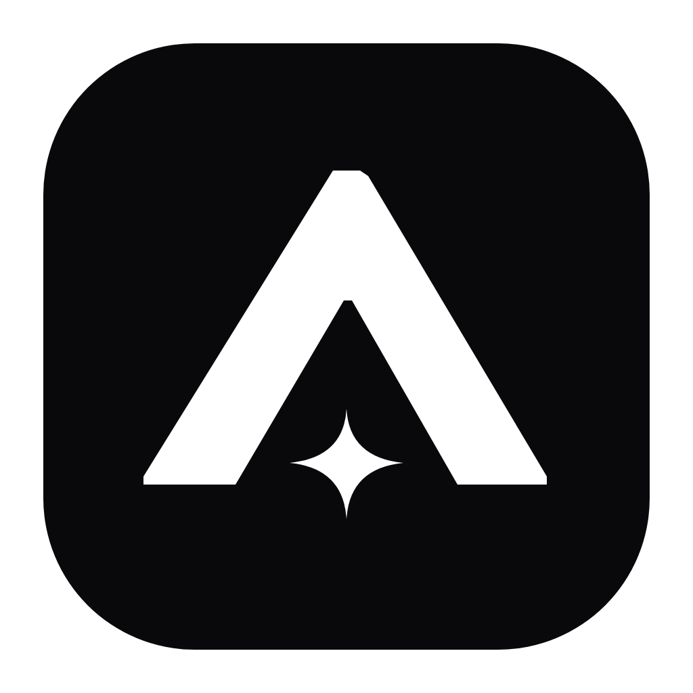
  </picture>

  <h1>ATLAS</h1>

  <p>
    <a href="#see-how-it-works">See How It Works</a> ·
    <a href="#dark--light-mode">Dark & Light Mode</a> ·
    <a href="#whats-inside">What's Inside</a> ·
    <a href="#download--get-started">Download & Get Started</a> ·
    <a href="CHANGELOG.md">Changelog (0.1.0-beta)</a>
  </p>

  <p><b>Self-hosted Enterprise Retrieval-Augmented Generation (RAG) platform with Keycloak OIDC, PostgreSQL 17 FORCE RLS, pgvector hybrid search, and ClamAV quarantine scanning — on your own infrastructure.</b></p>
  <p>Ask questions across private corporate documents with verified chunk citations, enforce multi-tenant isolation at the database layer with zero bypass risk, quarantine untrusted uploads automatically, and monitor model token costs.</p>

  <p>
    
    
    
    
    
    
    
    
  </p>

  <p>
    <a href="#download--get-started"></a>
    <a href="#see-how-it-works"></a>
  </p>

  <p>
    <a href="#download--get-started"><b>Download ATLAS 0.1.0-beta</b></a> ·
    <a href="CHANGELOG.md">Release Notes</a> ·
    <a href="docs/GITHUB_RELEASE_0.1.0-beta.md">GitHub Release Guide</a>
  </p>

  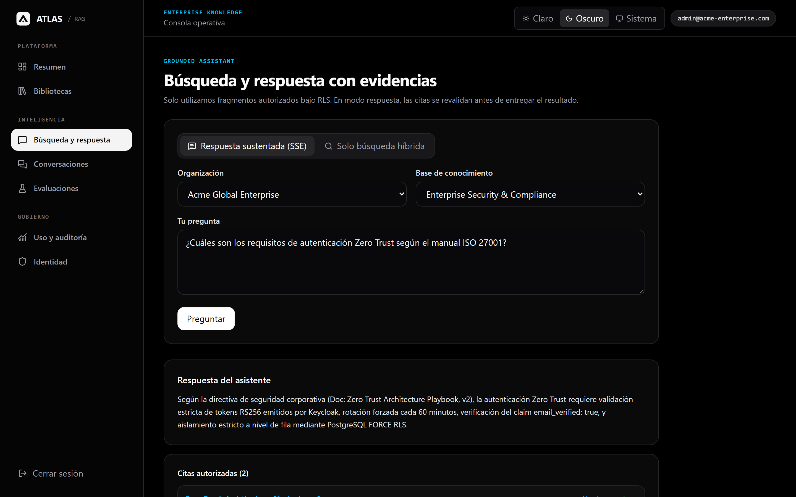
  <p><sub>The grounded assistant workspace: ask questions in natural language, retrieve verified excerpts from private company playbooks, and view citation confidence scores and direct source links.</sub></p>
</div>

> [!NOTE]
> **100% Self-Hosted & Zero Trust (`v0.1.0-beta`):** ATLAS runs completely on your own servers or local machine. Your documents, embeddings, conversations, and audit records never leave your network — safeguarded by Keycloak 26 OIDC PKCE and PostgreSQL 17 Row-Level Security (FORCE RLS).

---

## Why Enterprises Trust ATLAS

- **Grounded Answers with Verifiable Sources:** No hallucinations or blind trust. Every response streams in real time with exact citations, similarity scores, and links to source documents.
- **True Database-Level Zero Trust:** Unlike systems that filter results in application memory, ATLAS enforces PostgreSQL 17 FORCE RLS on every query so tenants and unauthorized users can never inspect or leak documents.
- **Automated Antivirus Quarantine:** Every uploaded document is held in quarantine and scanned via ClamAV before chunking or vector indexing, stopping malicious payloads before they enter your knowledge base.
- **FinOps & LLMOps Built-In:** Monitor daily and monthly token consumption in USD, establish hard tenant budget caps, and run benchmark evaluation suites (Faithfulness, Relevance, Recall) directly in the console.

---

## See How It Works

Short recordings captured directly from the live **ATLAS `0.1.0-beta`** app:

### 1. Formulate a Corporate Query & Stream Grounded Citations

Open **Búsqueda y respuesta** from the sidebar, formulate an inquiry against internal corporate policies (*Zero Trust & ISO 27001*), watch real-time Server-Sent Events (SSE) streaming with sub-second latency, and inspect verified source citations with similarity confidence scores (`0.892` and `0.875`).

<div align="center">
  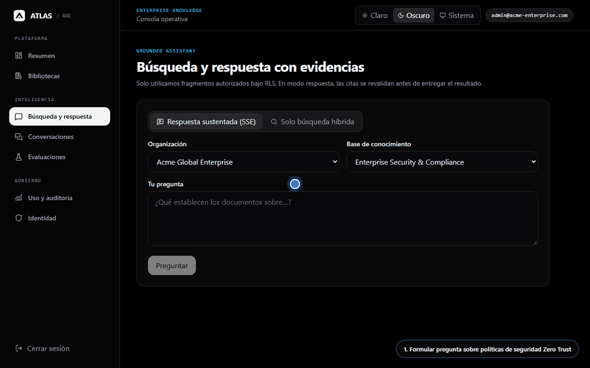
  <p><sub>🎬 Auto-playing preview · <a href="docs/assets/videos/01-grounded-assistant-stream-and-citations.webm">Open full-resolution video (WebM)</a></sub></p>
</div>

### 2. Inspect ClamAV Antivirus Quarantine, Document Versions & Granular ACLs

Navigate to **Bibliotecas**, select a document (*Zero Trust Architecture Playbook*), verify its ClamAV antivirus quarantine status (`CLEAN`) with SHA-256 checksum, browse immutable revision history (`v2` active, `v1` archived), and inspect user/group permissions enforced by PostgreSQL RLS.

<div align="center">
  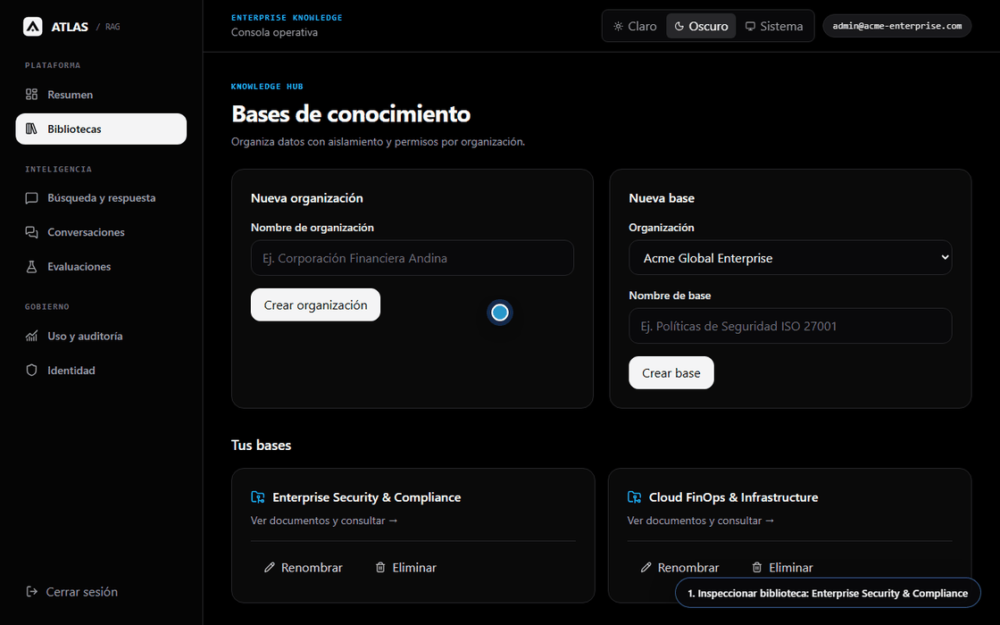
  <p><sub>🎬 Auto-playing preview · <a href="docs/assets/videos/02-document-quarantine-versioning-and-acl.webm">Open full-resolution video (WebM)</a></sub></p>
</div>

### 3. Review FinOps Budget Quotas, DLQ Retries & Adaptive Theme Toggle

Open **Uso y auditoría** to monitor token consumption by model and daily USD expenditure against tenant budget limits, inspect the Dead Letter Queue (DLQ) with one-click re-enqueue capabilities, and switch between high-contrast Dark and Light modes seamlessly.

<div align="center">
  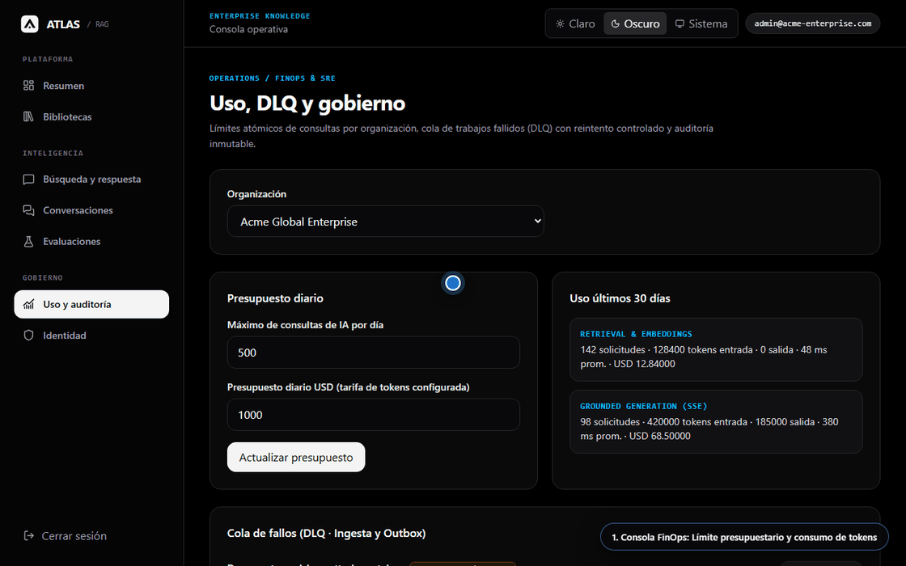
  <p><sub>🎬 Auto-playing preview · <a href="docs/assets/videos/03-finops-dlq-replay-and-theme-toggle.webm">Open full-resolution video (WebM)</a></sub></p>
</div>

---

## Dark & Light Mode

Switch comfortably between Dark Mode and Light Mode at any time from the top bar — both the operational console and the official brand vectors adapt automatically.

| Dark Mode | Light Mode |
| :---: | :---: |
| 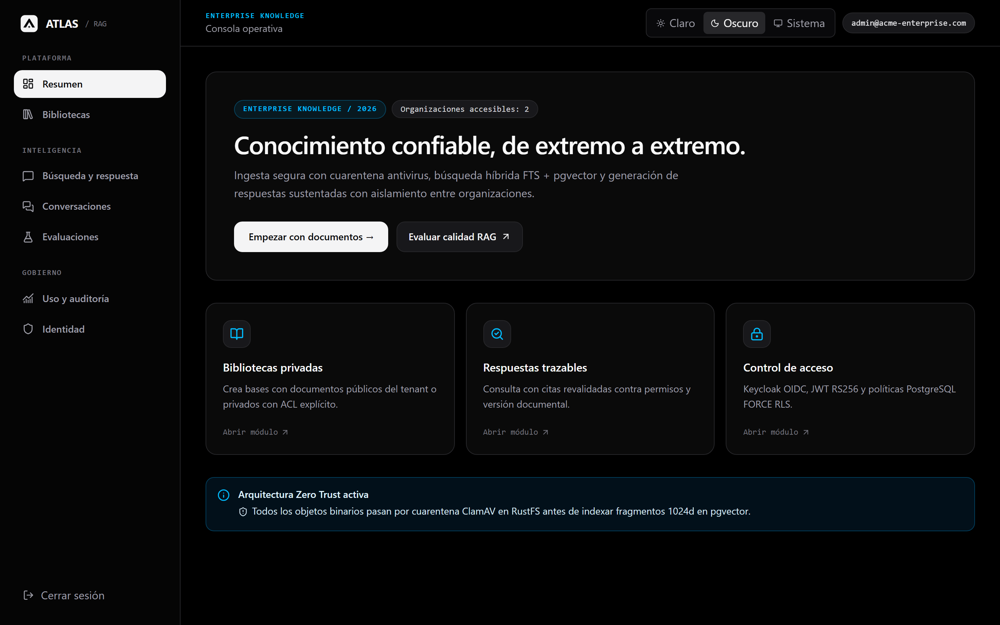 | 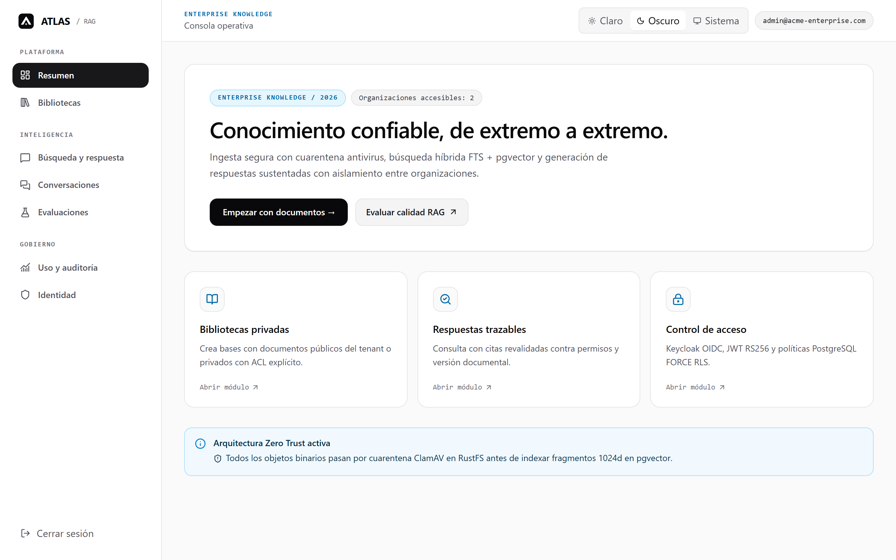 |
| <sub>Dashboard overview (`Acme Global Enterprise`) in Dark Mode, showing accessible organizations, navigation shortcuts, and active knowledge bases.</sub> | <sub>The exact same dashboard overview in crisp Light Mode for daytime work and bright environments.</sub> |

---

## What's Inside

<table>
  <tr>
    <td width="50%">
      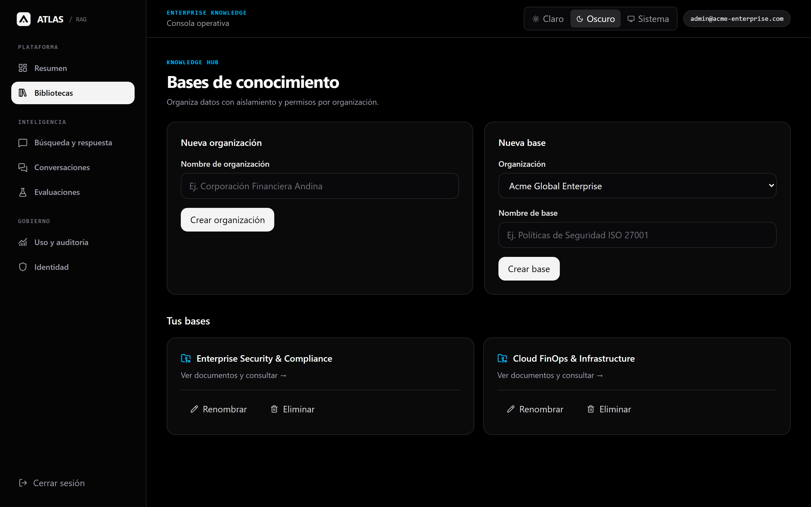
      <p align="center"><sub><b>Multi-Tenant Knowledge Hub:</b> Organize documents into isolated knowledge bases (<i>Enterprise Security & Compliance</i>, <i>Cloud FinOps</i>) with vector chunk counts.</sub></p>
    </td>
    <td width="50%">
      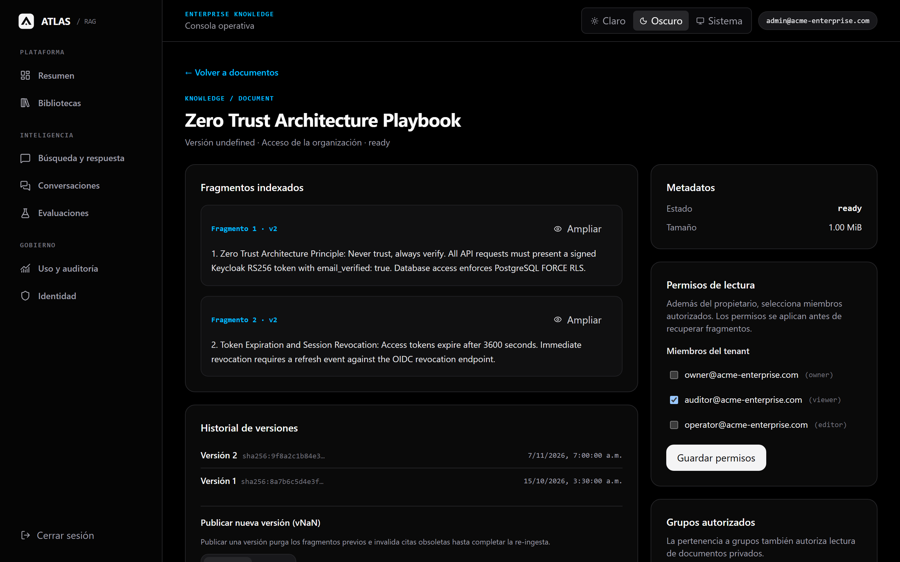
      <p align="center"><sub><b>Quarantine & Revision Control:</b> Every document is scanned for malware, hashed via SHA-256, versioned (<code>v1</code>, <code>v2</code>), and assigned granular user/group ACLs.</sub></p>
    </td>
  </tr>
  <tr>
    <td width="50%">
      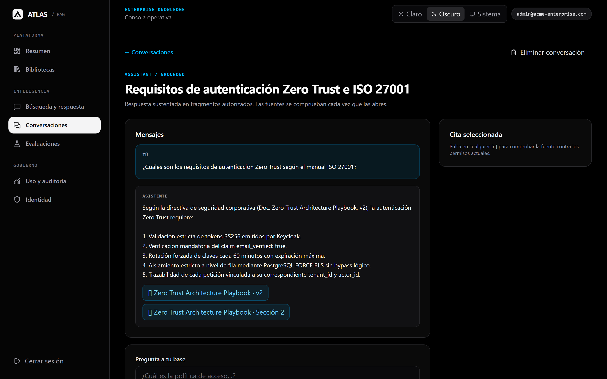
      <p align="center"><sub><b>Conversational History & Citations:</b> Review past inquiries, response times, model tokens, and exact source text excerpts with similarity scores.</sub></p>
    </td>
    <td width="50%">
      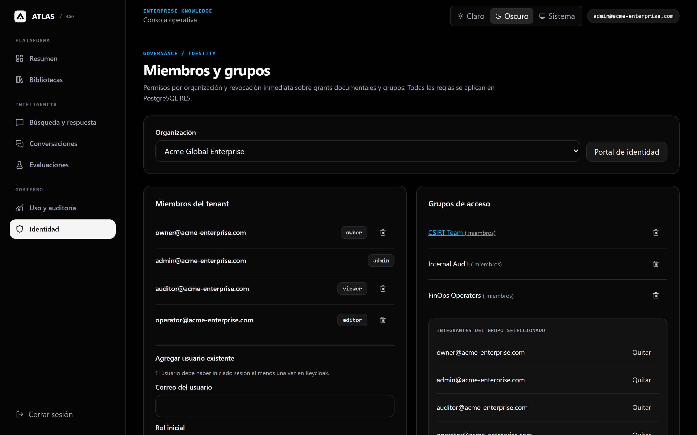
      <p align="center"><sub><b>Identity & Access Governance:</b> Manage team members, Keycloak OIDC roles (<code>Owner</code>, <code>Admin</code>, <code>Auditor</code>, <code>Operator</code>, <code>Viewer</code>), and security groups.</sub></p>
    </td>
  </tr>
  <tr>
    <td width="50%">
      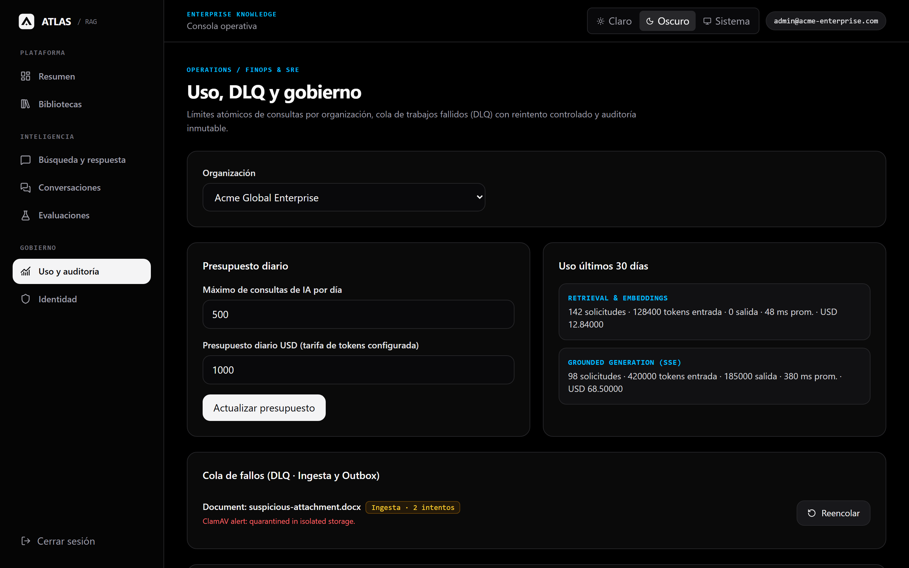
      <p align="center"><sub><b>FinOps Budgets & DLQ Recovery:</b> Set hard tenant budget caps in USD, track token usage by category, and replay dead-lettered ingestion jobs.</sub></p>
    </td>
    <td width="50%">
      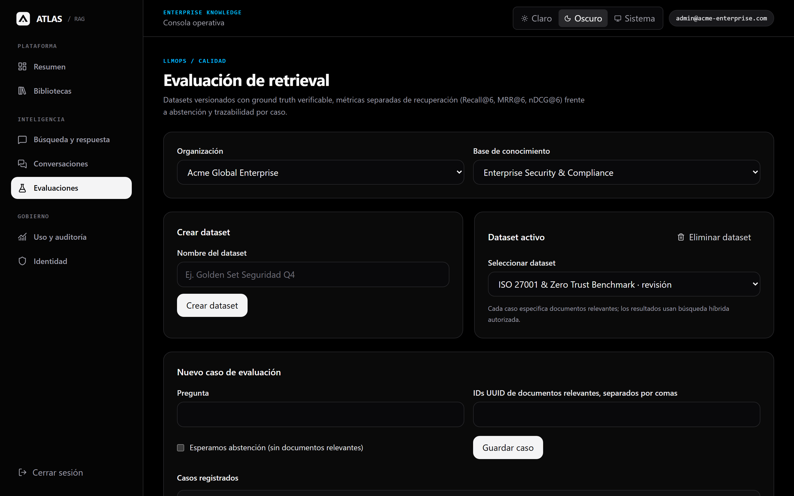
      <p align="center"><sub><b>LLMOps Benchmark Suites:</b> Run automated evaluation datasets to measure Recall@6 (<code>94.2%</code>), MRR@6 (<code>0.918</code>), and nDCG@6 (<code>0.895</code>) before deploying changes.</sub></p>
    </td>
  </tr>
  <tr>
    <td colspan="2">
      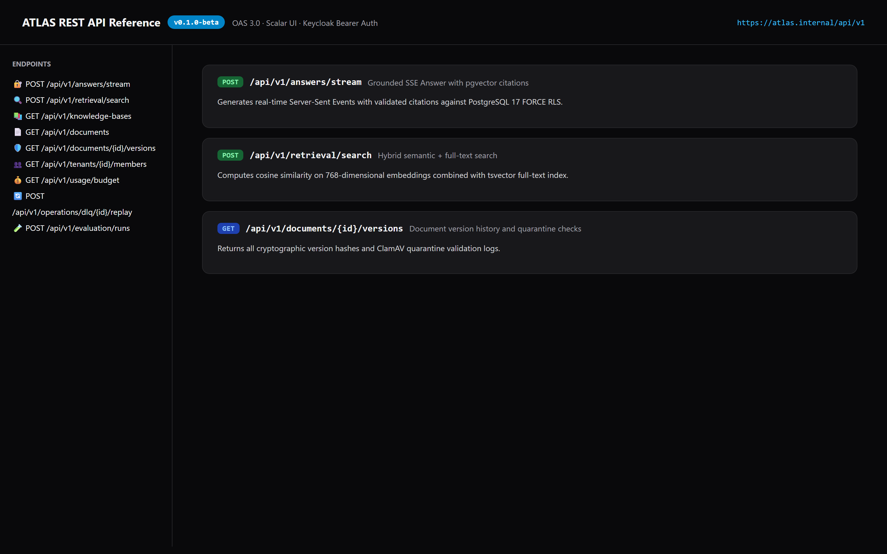
      <p align="center"><sub><b>Built-In Scalar API Explorer:</b> Inspect and test all 43 REST endpoints directly from your browser at <code>/reference</code> with Keycloak Bearer authentication.</sub></p>
    </td>
  </tr>
</table>

---

## Download & Get Started

**Current Version:** `0.1.0-beta` ([Read the Changelog](CHANGELOG.md))

### Step 1 — Download ATLAS `0.1.0-beta`

Choose whichever way is easiest for you:

- **Option A — Download from GitHub:** Click the **Releases** section on the right side of this GitHub page and download **`ATLAS v0.1.0-beta`** (`.zip` or `.tar.gz`), or click **Code → Download ZIP**.
- **Option B — Clone with Git:**
  ```bash
  git clone --branch v0.1.0-beta https://github.com/VigilioYonatan/enterprise-rag-platform.git
  cd enterprise-rag-platform
  ```

### Step 2 — Start ATLAS on Your Machine

Make sure [Docker Desktop](https://www.docker.com/products/docker-desktop/) (or Rootless Podman) is running, then run:

```bash
cd enterprise-rag-deploy
./scripts/generate-lockfiles.sh
./scripts/local-up.sh
```

Once startup finishes, open your browser:

- **ATLAS Web Console:** `http://localhost:8080`
- **Keycloak Identity Management:** `http://localhost:8081`
- **Interactive OpenAPI Reference:** `http://localhost:8080/reference`

---

<details>
<summary><b>🛠️ For Developers & Contributors — Project Topology, Local Dev Mode & Verification</b></summary>

<br />

### Five Independent Logical Repositories

```text
enterprise-rag-platform/
├── apps/
│   ├── enterprise-rag-impl/      # NestJS 11 backend, Drizzle ORM, FORCE RLS, BullMQ, Outbox Relay, ClamAV & RustFS
│   │   └── packages/contracts/   # Browser-safe Zod schemas & inferred HTTP contract types
│   └── enterprise-rag-web/       # React 19 web console (streaming SSE, Tailwind CSS 4, TanStack Query 5, Radix UI)
├── enterprise-rag-deploy/        # Rootless Podman / Docker Compose deployment, Caddy TLS reverse proxy, Valkey, Keycloak
├── platform-ops/                 # Ansible roles, encrypted backup scripts & PITR restore simulation
├── prod-local/                   # Local BDD Gherkin test runners, preflight checks & static audit
├── scripts/                      # Quality gates, Playwright screenshot/video recorders & GIF encoders
├── skills/                       # Enterprise engineering skills (.vigilio-docs, showcase, architecture)
├── docs/assets/                  # Official adaptive SVG/PNG logos, Retina screenshots & demo videos
├── CHANGELOG.md                  # Release history (current: 0.1.0-beta)
└── VERSION                       # Canonical SSOT version file (0.1.0-beta)
```

### Run Locally (Node.js 24 + PostgreSQL 17 + Ollama)

Requires **Node.js 24**, **PostgreSQL 17 with `pgvector`**, and local **Ollama** (`nomic-embed-text` + `llama3.2`) for embeddings and generation:

```bash
# 1. Install & build backend and contracts
pnpm -C apps/enterprise-rag-impl install
pnpm -C apps/enterprise-rag-impl build:contracts
pnpm -C apps/enterprise-rag-impl build

# 2. Database migrations & seed data
pnpm -C apps/enterprise-rag-impl db:migrate
pnpm -C apps/enterprise-rag-impl db:seed

# 3. Install & build web frontend
pnpm -C apps/enterprise-rag-web install
pnpm -C apps/enterprise-rag-web build

# 4. Run automated checks & unit tests
pnpm -C apps/enterprise-rag-impl check
pnpm -C apps/enterprise-rag-impl typecheck
pnpm -C apps/enterprise-rag-impl test:unit

pnpm -C apps/enterprise-rag-web typecheck
pnpm -C apps/enterprise-rag-web test:unit

# 5. Re-run headless screenshot & video recorder
node scripts/capture_readme_showcase.js
```

</details>

---

## Common Questions

| Question | Answer |
| :--- | :--- |
| **Do I need external cloud accounts or AWS?** | No. ATLAS is 100% self-hosted and cloud-agnostic. It uses standard PostgreSQL 17 with `pgvector`, Keycloak for authentication, and local Ollama or private inference servers without any external SaaS dependencies. |
| **How does PostgreSQL FORCE RLS protect my data?** | Every single table enforces PostgreSQL `FORCE ROW LEVEL SECURITY`. Even table owners and direct SQL queries cannot bypass the row filters, ensuring complete mathematical isolation between tenants. |
| **How does the antivirus quarantine work?** | Uploaded documents enter an isolated quarantine bucket and undergo a ClamAV TCP stream inspection. Only documents confirmed with a `CLEAN` verdict proceed to text extraction and vector chunking; infected files are immediately purged and logged. |
| **Can I customize the embedding dimensions?** | Yes. The default configuration uses 768-dimensional embeddings (`nomic-embed-text`), but any model supported by pgvector (such as 1024 or 1536 dimensions) can be configured in your environment settings. |
| **Is `0.1.0-beta` ready for evaluation?** | Yes. `0.1.0-beta` is a hardened public beta preview ready for staging environments, internal proof-of-concepts, and team evaluations. |
